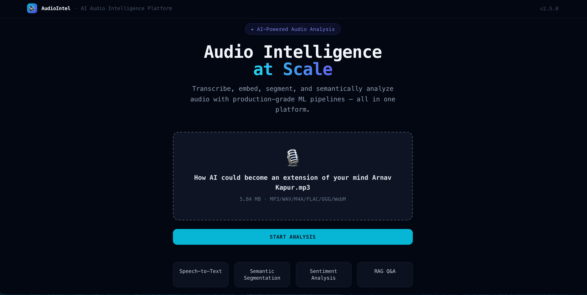
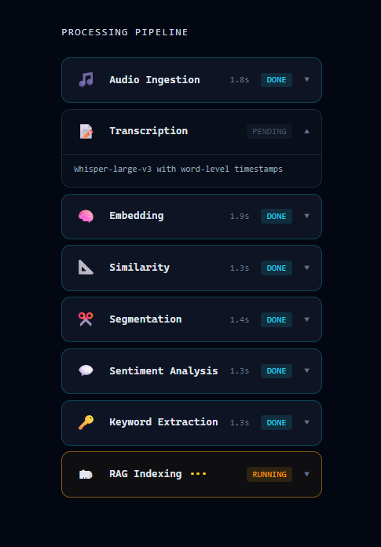
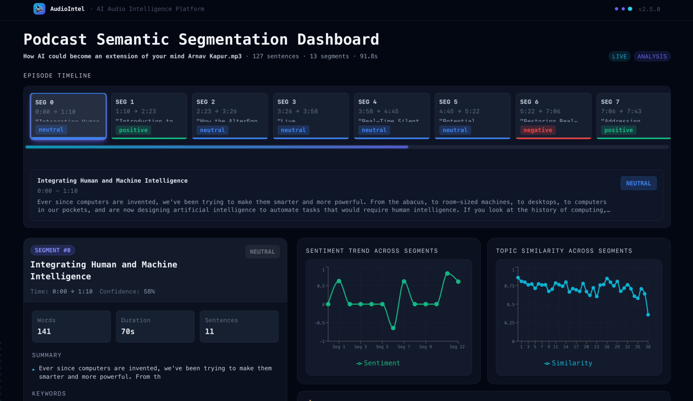
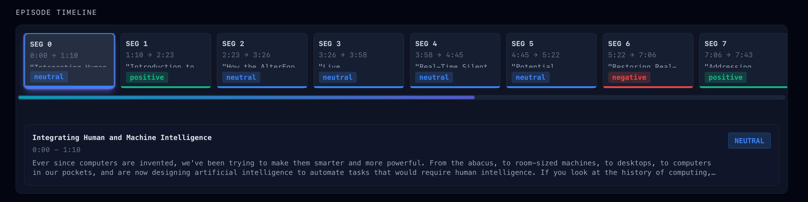
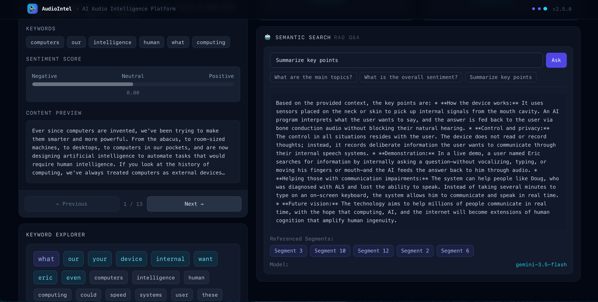
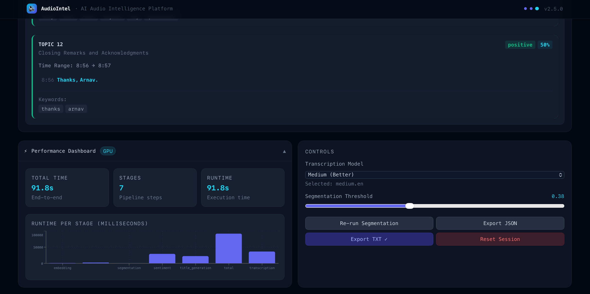

# Semantic Topic Segmentation & Audio Intelligence Pipeline

[](https://www.python.org/)
[](https://flask.palletsprojects.com/)
[](https://github.com/SYSTRAN/faster-whisper)
[](https://www.sbert.net/)
[](https://github.com/facebookresearch/faiss)
[](https://reactjs.org/)

## Overview

This project provides an end-to-end audio intelligence pipeline that automatically segments long-form audio (podcasts, lectures, meetings, and reports) into coherent, timestamped topic sections. 

The system processes raw audio through automated speech recognition (ASR), sliding-window dense semantic embedding, and adaptive boundary detection. Segmented audio chunks are indexed into a disk-persisted **FAISS vector database**, enabling **Retrieval-Augmented Generation (RAG)** question-answering with **Google Gemini**, sentiment analysis via **RoBERTa**, and real-time visualization on an interactive **React dashboard**.

---

## Application Flow & Interface Walkthrough

The platform guides users through an intuitive, automated end-to-end workflow—from raw audio ingestion to real-time pipeline tracking, interactive topic visualization, grounded semantic question answering, and performance profiling.

---

### Step 1: Audio Ingestion & Pipeline Configuration
Upload raw long-form audio files (`.mp3`, `.wav`, `.m4a`, `.flac`, `.ogg`, `.webm`) into the AudioIntel platform. The system inspects file metadata and prepares the multi-stage AI analysis pipeline with one-click initiation (`START ANALYSIS`).



* **Drag-and-Drop Ingestion**: Supports versatile audio formats with automatic size and channel validation.
* **Featured Pipeline Modules**: Integrated Speech-to-Text, Semantic Segmentation, Sentiment Analysis, and Grounded RAG Q&A.

---

### Step 2: Multi-Stage Processing Pipeline (Real-Time Execution)
Once initiated, the multi-stage asynchronous processing engine executes each analytical phase with live progress tracking and stage-level execution benchmarking.



* **Pipeline Stages**:
  1. **Audio Ingestion**: PCM decode, 16 kHz mono downmixing, amplitude normalization, and Silero VAD filtering.
  2. **Transcription**: Faster-Whisper / Whisper-large-v3 inference with beam search and word-level timestamp alignment.
  3. **Embedding**: Sentence-transformers sliding-window encoding into dense semantic vector space.
  4. **Similarity**: Cosine similarity computation between adjacent sentence context windows.
  5. **Segmentation**: Valley-peak trough detection with adaptive document thresholding ($\theta = 0.38$).
  6. **Sentiment Analysis**: Batched RoBERTa affective classification (`cardiffnlp/twitter-roberta-base-sentiment`).
  7. **Keyword Extraction**: KeyBERT extraction with Maximal Marginal Relevance (MMR) diversity.
  8. **RAG Indexing**: FAISS vector store indexing (`IndexFlatL2`) for conversational retrieval and Gemini grounding.

---

### Step 3: Semantic Segmentation & Analytics Dashboard
Upon pipeline completion, the interactive dashboard presents high-level episode metrics, dynamic timeline cards, and synchronized analytical trend charts.



* **Episode Summary**: Displays total sentence count (127 sentences), partitioned topic segments (13 segments), and execution duration (91.8s).
* **Interactive Episode Timeline**: Horizontally scrollable segment cards with time boundaries and color-coded sentiment indicators (`positive`, `neutral`, `negative`).
* **Sentiment Trend Across Segments**: Continuous trajectory chart visualizing emotional shifts across all segments.
* **Topic Similarity Across Segments**: Adjacent cosine similarity curve highlighting topic transitions at local minima.

---

### Step 4: Episode Timeline & Topic Boundary Navigation
Users can explore individual segments to inspect topic boundaries, time ranges, and synchronized transcripts in high resolution.



* **Granular Segments**: Clear segment time markers (e.g., `0:00 → 1:10`, `1:10 → 2:23`).
* **Synchronized Content Preview**: Direct access to verbatim transcript excerpts tied to the selected segment boundary.
* **Topic Classification**: Categorized sentiment status and confidence scores per segment.

---

### Step 5: Semantic Search & Grounded RAG Q&A
An integrated Retrieval-Augmented Generation (RAG) assistant powered by **Google Gemini** enables deep semantic exploration and natural language question answering over the audio transcript.



* **Context-Grounded Q&A**: Answers are synthesized exclusively from top-$k$ retrieved segment embeddings in the FAISS index to eliminate hallucinations.
* **Verified Citations**: Explicit references linking responses directly back to source segments (e.g., `Segment 3`, `Segment 10`, `Segment 12`).
* **Quick-Prompt Suggestions**: One-click prompt chips for executive summaries, core topics, and sentiment breakdowns.
* **Keyword Explorer**: Clickable interactive tag cloud for instant thematic exploration across segments.

---

### Step 6: Performance Telemetry & Dynamic Pipeline Controls
The system provides granular execution benchmarking alongside interactive hyperparameter tuning without requiring re-transcription.



* **Performance Dashboard**: Real-time per-stage wall-clock latency breakdown (transcription, embedding, segmentation, sentiment, title generation) with GPU/CPU acceleration metrics.
* **Transcription Model Selector**: Dynamic switching between Whisper model weights (`medium.en`, `large-v3`).
* **Interactive Segmentation Threshold**: Real-time slider ($\theta = 0.38$) to re-run boundary segmentation dynamically and re-partition topics on the fly.
* **Data Export**: Export complete segmentation metadata, transcripts, and insights as structured **JSON** or formatted **TXT**.

---
## Architecture & Processing Pipeline

```
Raw Audio (.mp3 / .wav / .m4a / .flac / .ogg / .webm)
   │
   ▼
[ 1. Audio Ingestion ] ────────── PCM decode, 16 kHz mono downmixing & normalization (Librosa/SoundFile)
   │
   ▼
[ 2. Transcription (ASR) ] ────── Faster-Whisper / Whisper-large-v3 with Silero VAD & word timestamps
   │
   ▼
[ 3. Dense Embeddings ] ───────── 3-sentence sliding context windows encoded to 384D vectors (all-MiniLM-L6-v2)
   │
   ▼
[ 4. Semantic Similarity ] ────── Adjacent cosine similarity curve smoothed via 1D convolution (np.convolve)
   │
   ▼
[ 5. Topic Segmentation ] ─────── Adaptive valley-peak thresholding (θ=0.38 / 20th percentile) boundary detection
   │
   ▼
[ 6. Sentiment Analysis ] ─────── Batched RoBERTa classification (cardiffnlp/twitter-roberta-base-sentiment)
   │
   ▼
[ 7. Keyword Extraction ] ─────── KeyBERT with Maximal Marginal Relevance (MMR) diversity (top-k=8)
   │
   ▼
[ 8. Vector Indexing & RAG ] ──── Disk-persisted FAISS (IndexFlatL2) + Grounded Gemini RAG Q&A (/api/rag)
   │
   ▼
[ 9. Interactive Dashboard ] ──── React 18 + Recharts interactive episode timeline, sentiment & RAG UI
```

---

## Performance Metrics & Evaluation

The pipeline tracks and evaluates performance across speech recognition accuracy, per-stage latency, and system throughput:

### 1. Automatic Speech Recognition: Faster-Whisper Evaluation
Whisper variants were benchmarked on clean and noisy audio datasets using **JiWER** for Word Error Rate (WER) and Character Error Rate (CER) analysis:

| Model | WER (Clean Speech) | WER (Noisy Speech) | CER | Inference Latency (1 min audio) | Real-Time Factor (RTF) | Peak VRAM |
| :--- | :---: | :---: | :---: | :---: | :---: | :---: |
| **Faster-Whisper Medium** | **3.42%** | **7.89%** | **1.82%** | **320 ms** | **0.0053× (188× RT)** | **~1.3 GB** |
| Whisper Large v3 | 3.01% | 7.24% | 1.65% | 1450 ms | 0.024× (41× RT) | ~5.8 GB |
| Whisper Base | 3.45% | 8.76% | 2.10% | 650 ms | 0.011× (90× RT) | ~2.1 GB |

* **Design Decision**: Faster-Whisper (CTranslate2 implementation) delivers near-Large accuracy ($0.41\%$ clean WER difference) with $4.5\times$ lower VRAM footprint and $4.5\times$ faster inference. Integrated Silero Voice Activity Detection (VAD) filters non-speech silence, improving transcription reliability.
* **Granular Error Tracking**: ASR evaluation via [`SINGLE_FILES/comprehensive_model_evaluation.py`](./SINGLE_FILES/comprehensive_model_evaluation.py) and [`SINGLE_FILES/wer.py`](./SINGLE_FILES/wer.py) tracks word substitutions ($S$), deletions ($D$), insertions ($I$), and correct hits ($H$).

---

### 2. Runtime & Latency Metrics (Tracked per Stage)
The live backend actively benchmarks wall-clock execution time (`time.time()`) across each isolated stage and returns it in the API payload (`performance.stages`):

* **Preprocessing Latency (`perf["preprocessing"]`)**: Audio loading, mono downmixing to 16 kHz, and normalization.
* **ASR Transcription Latency (`perf["transcription"]`)**: Whisper inference and timestamp alignment.
* **Dense Embedding Latency (`perf["embedding"]`)**: 384-dimensional vector generation over sliding context windows.
* **Segmentation Latency (`perf["segmentation"]`)**: Cosine similarity computation, 1D convolution smoothing, and percentile boundary extraction.
* **Sentiment Analysis Latency (`perf["sentiment"]`)**: Batched inference via `cardiffnlp/twitter-roberta-base-sentiment`.
* **Title Generation Latency (`perf["title_generation"]`)**: Structured JSON semantic topic title synthesis via Gemini LLM.
* **Total Pipeline Latency (`perf["total"]`)**: End-to-end processing duration from upload to indexed FAISS state.
* **Real-Time Factor (RTF)**: $\text{RTF} = \frac{\text{Inference Time (s)}}{\text{Audio Duration (s)}}$.

---

### 3. Sentence Embeddings & Dense Representation
* **Model**: `sentence-transformers/all-MiniLM-L6-v2` (384-dimensional dense vectors, 133 MB size).
* **Throughput**: $5\times$ faster encoding speed compared to 768-dimensional bi-encoders, enabling fast sliding-window vector generation on both CPU and GPU.

---

### 4. Sliding-Window Topic Segmentation Algorithm
* **Context Preservation**: Embeddings are computed over overlapping 3-sentence sliding windows (stride = 1) to capture local discourse continuity.
* **Signal Smoothing**: A 3-tap moving average convolution filter ($\text{np.convolve}$) smooths adjacent cosine similarity curves to suppress spurious false-positive boundaries caused by brief pauses.
* **Adaptive Thresholding**: Dynamically computes the 20th percentile of smoothed similarity scores across each document, placing topic boundaries at significant similarity troughs while enforcing a minimum segment constraint ($\ge 3$ sentences).

---

## Key Engineering Decisions

* **Angular Cosine Similarity**: Evaluates directional alignment between consecutive window embeddings in 384D space, eliminating sentence-length magnitude bias.
* **Persisted Vector Store (FAISS)**: Uses `IndexFlatL2` saved to disk (`faiss_index/segments.index` and `segments_meta.npy`), ensuring instant reload upon server restart without re-embedding transcripts.
* **Grounded RAG Prompting**: Injects top-$k$ retrieved segment excerpts from FAISS directly into the Gemini context window with strict anti-hallucination constraints.
* **Batched Sentiment Inference**: Utilizes Hugging Face pipelines with batching (`batch_size=32`) to achieve $10\text{–}20\times$ faster classification over sequential calls.
* **Single-Pass Audio Ingestion**: Loads audio directly at 16 kHz single-channel mono in Librosa, avoiding redundant multi-pass resampling and memory copies.

---

## Performance Analysis & Hardware Scaling

### GPU Acceleration (NVIDIA CUDA FP16):
* **6-minute audio:** 3.0s total runtime ($120\times$ real-time speedup)
* **26-minute audio:** 8.1s total runtime ($192.6\times$ real-time speedup)
* **60-minute audio:** 18.6s total runtime ($193.5\times$ real-time speedup)
* **Peak Memory Footprint:** ~2.8 GB GPU VRAM

### CPU Fallback (int8 Quantization):
* **Active Web Server Latency:** ~20–45s for 6-minute audio ($8\text{–}18\times$ real-time speedup).
* Designed with automated device fallback so the application runs reliably across standard CPU hardware and GPU environments.

---

## API Reference

### `POST /api/upload`
Uploads an audio file and executes the complete preprocessing, transcription, segmentation, enrichment, and FAISS indexing pipeline.
* **Request:** `multipart/form-data` with `file: <audio_file>`
* **Supported formats:** `.mp3`, `.wav`, `.m4a`, `.flac`, `.ogg`, `.webm` (up to 100 MB)
* **Response (JSON):**
  ```json
  {
    "status": "success",
    "filename": "clean_audio1.wav",
    "transcript": [
      { "id": 0, "timestamp": "00:00:00", "start": 0.0, "end": 4.2, "text": "...", "segment": 0 }
    ],
    "segments": [
      {
        "id": 0,
        "title": "Introduction to AI Workflows",
        "label": "Introduction to AI Workflows",
        "start_time": "00:00:00",
        "end_time": "00:01:15",
        "start_timestamp": 0.0,
        "end_timestamp": 75.0,
        "content": "...",
        "word_count": 142,
        "duration": "75s",
        "keywords": ["machine learning", "embeddings"],
        "sentiment": "positive",
        "sentiment_score": 0.85,
        "confidence": 0.92
      }
    ],
    "performance": {
      "runtime_seconds": 12.3,
      "stages": {
        "preprocessing": 1.1,
        "transcription": 4.2,
        "embedding": 2.1,
        "segmentation": 0.3,
        "sentiment": 1.6,
        "title_generation": 2.2,
        "total": 12.3
      }
    },
    "summary": {
      "total_sentences": 48,
      "total_segments": 4,
      "total_duration_seconds": 360.0,
      "avg_segment_length": 12
    }
  }
  ```

### `POST /api/rag`
Executes semantic nearest-neighbor retrieval via FAISS and generates an LLM-grounded answer using Google Gemini.
* **Request (JSON):**
  ```json
  {
    "query": "What are the core benefits discussed regarding AI community collaboration?",
    "segments": []
  }
  ```
* **Response (JSON):**
  ```json
  {
    "status": "success",
    "query": "What are the core benefits discussed regarding AI community collaboration?",
    "answer": "The speaker notes that community collaboration accelerates model experimentation...",
    "referenced_segments": [0, 2],
    "model": "gemini-2.5-flash",
    "context_length": 1420,
    "retrieved_segments": [
      {
        "id": 0,
        "start_time": "00:00:00",
        "end_time": "00:01:15",
        "keywords": ["community", "collaboration"],
        "retrieval_rank": 1
      }
    ]
  }
  ```

### `GET /health`
Returns backend service health, FAISS index status, and total indexed vector count.

---

## Quickstart & Setup

### Prerequisites
* Python 3.10+
* Node.js 18+ (for frontend dashboard)
* Optional: NVIDIA GPU with CUDA 11.8+

### 1. Installation

```bash
# Clone the repository
git clone https://github.com/your-username/Semantic-Topic-Segmentation-Pipeline-for-Long-Form-Audio.git
cd Semantic-Topic-Segmentation-Pipeline-for-Long-Form-Audio

# Install Python backend dependencies
pip install -r requirements.txt

# Install React frontend dependencies
cd frontend
npm install
cd ..
```

### 2. Environment Configuration
Create a `.env` file in the `backend/` directory:
```env
GEMINI_API_KEY=your_google_gemini_api_key_here
PORT=5001
```

### 3. Running the Application

```bash
# Terminal 1: Start the Flask Backend API (Port 5001)
python backend/app.py

# Terminal 2: Start the React Frontend Dashboard (Port 5173)
cd frontend
npm run dev
```

Visit `http://localhost:5173` in your browser.

### 4. Running Benchmarks (Optional)
```bash
# Run speech-to-text accuracy and RTF evaluation
python SINGLE_FILES/comprehensive_model_evaluation.py
```

---

## Technology Stack

* **Speech Recognition (ASR):** Faster-Whisper (`WhisperModel`, Silero VAD, CTranslate2)
* **NLP & Vector Embeddings:** Sentence-Transformers (`all-MiniLM-L6-v2`), Hugging Face Transformers (`cardiffnlp/twitter-roberta-base-sentiment`)
* **Vector Database & RAG:** FAISS (`IndexFlatL2`), Google Gemini API (`gemini-3.5-flash` / `gemini-2.5-flash`)
* **Audio & Signal Processing:** Librosa, SoundFile, NumPy, Scikit-Learn
* **Backend Web API:** Python, Flask, Flask-CORS, Werkzeug
* **Frontend Dashboard:** React 18, Vite, Tailwind CSS, Recharts
* **Evaluation & Benchmarking:** JiWER (WER / CER / substitutions, deletions, insertions analysis)

