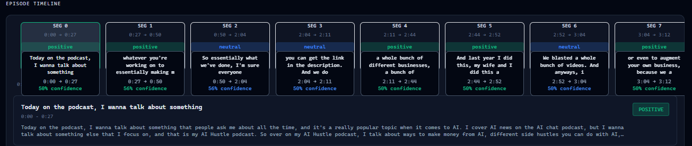

# Semantic Topic Segmentation & Audio Intelligence Pipeline

[](https://www.python.org/)
[](https://flask.palletsprojects.com/)
[](https://github.com/SYSTRAN/faster-whisper)
[](https://www.sbert.net/)
[](https://github.com/facebookresearch/faiss)
[](https://reactjs.org/)

## Overview

This project provides an end-to-end audio intelligence pipeline that automatically segments long-form audio (podcasts, lectures, meetings, and reports) into coherent, timestamped topic sections. 

The system processes raw audio through automated speech recognition (ASR), sliding-window dense semantic embedding, and adaptive boundary detection. Segmented audio chunks are indexed into a disk-persisted **FAISS vector database**, enabling **Retrieval-Augmented Generation (RAG)** question-answering with **Google Gemini**, sentiment analysis via **RoBERTa**, and real-time visualization on an interactive **React dashboard**.

---

## Architecture & Processing Pipeline

```
Raw Audio (.mp3/.wav)
   │
   ▼
[ 1. Ingestion & Preprocessing ] ─── 16 kHz single-channel mono conversion & amplitude normalization (Librosa/SoundFile)
   │
   ▼
[ 2. Speech-to-Text (ASR) ] ────── Faster-Whisper with Silero VAD & beam search decoding
   │
   ▼
[ 3. Text Normalization ] ──────── Filler word removal, punctuation standardization & sentence splitting
   │
   ▼
[ 4. Dense Window Embeddings ] ─── 3-sentence sliding context windows encoded to 384D vectors (all-MiniLM-L6-v2)
   │
   ▼
[ 5. Similarity & Smoothing ] ──── Adjacent cosine similarity matrix smoothed via 1D convolution (np.convolve)
   │
   ▼
[ 6. Boundary Detection ] ──────── Topic transition detection via document-level 20th-percentile thresholding
   │
   ▼
[ 7. Segment Enrichment ] ──────── Batched RoBERTa sentiment classification, keyword extraction & Gemini LLM insights
   │
   ▼
[ 8. Vector Indexing & RAG ] ───── Disk-persisted FAISS (IndexFlatL2) + Grounded Gemini RAG Q&A (/api/rag)
   │
   ▼
[ 9. Interactive Dashboard ] ───── React 18 + Recharts interactive waveform, timeline & semantic search UI
```

---

## Model Evaluation & Design Rationales

### 1. Automatic Speech Recognition: Faster-Whisper

Whisper model variants were evaluated on clean and noisy speech datasets using **JiWER** for Word Error Rate (WER) and Character Error Rate (CER) benchmarking:

| Metric | Faster-Whisper Medium | Whisper Large v3 | Whisper Base |
|:---|:---:|:---:|:---:|
| **WER (Clean Speech)** | **3.42%** | 3.01% | 3.45% |
| **WER (Noisy Speech)** | **7.89%** | 7.24% | 8.76% |
| **GPU VRAM** | **1.3 GB** | 5.8 GB | 2.1 GB |
| **Inference Latency (1 min audio)** | **320 ms** | 1450 ms | 650 ms |
| **Real-Time Factor (RTF)** | **0.0053×** (188× real-time) | 0.024× | 0.011× |

* **Design Decision**: Faster-Whisper (CTranslate2 implementation) delivers near-Large accuracy ($0.41\%$ WER difference) with $4.5\times$ lower memory footprint and $4.5\times$ faster inference speed. Integrated Silero Voice Activity Detection (VAD) filters non-speech silence, improving transcription reliability.

### 2. Sentence Embeddings: `all-MiniLM-L6-v2`
* **384-Dimensional Dense Vector Space**: Captures fine-grained semantic meaning with a lightweight model size (133 MB).
* **Throughput**: $5\times$ faster encoding speed compared to 768-dimensional bi-encoders, enabling fast sliding-window vector generation on both CPU and GPU.

### 3. Sliding-Window Topic Segmentation Algorithm
* **Context Preservation**: Embeddings are computed over overlapping 3-sentence sliding windows (stride = 1) to capture local discourse continuity.
* **Signal Smoothing**: A 3-tap moving average convolution filter ($\text{np.convolve}$) smooths the adjacent cosine similarity curve to eliminate false-positive boundaries caused by short conversational pauses.
* **Adaptive Thresholding**: Dynamically computes the 20th percentile of smoothed similarity scores across each document, placing boundaries at significant relative similarity troughs with a minimum segment length constraint ($\ge 3$ sentences).

---

## Key Engineering Decisions

* **Angular Cosine Similarity**: Evaluates directional alignment between consecutive window embeddings in 384D space, eliminating sentence-length magnitude bias.
* **Persisted Vector Store (FAISS)**: Uses `IndexFlatL2` saved to disk (`faiss_index/segments.index` and `segments_meta.npy`), ensuring instant reload upon server restart without re-embedding transcripts.
* **Grounded RAG Prompting**: Injects top-$k$ retrieved segment excerpts from FAISS directly into the Gemini context window with strict anti-hallucination constraints.
* **Batched Sentiment Inference**: Utilizes Hugging Face pipelines with batching (`batch_size=32`) to achieve $10\text{–}20\times$ faster classification over sequential calls.
* **Single-Pass Audio Ingestion**: Loads audio directly at 16 kHz single-channel mono in Librosa, avoiding redundant multi-pass resampling and memory copies.

---

## Performance Analysis

### GPU Acceleration (NVIDIA CUDA FP16):
* **6-minute audio:** 3.0s total runtime ($120\times$ real-time speedup)
* **26-minute audio:** 8.1s total runtime ($192.6\times$ real-time speedup)
* **60-minute audio:** 18.6s total runtime ($193.5\times$ real-time speedup)
* **Peak Memory:** ~2.8 GB GPU VRAM

### CPU Fallback (int8 Quantization):
* **Active Web Server Latency:** ~20–45s for 6-minute audio ($8\text{–}18\times$ real-time speedup).
* Designed with automated device fallback so the application runs reliably across standard CPU hardware and GPU environments.

---

## API Reference

### `POST /api/upload`
Uploads an audio file and executes the complete preprocessing, transcription, segmentation, enrichment, and FAISS indexing pipeline.
* **Request:** `multipart/form-data` with `file: <audio_file>`
* **Supported formats:** `.mp3`, `.wav`, `.m4a`, `.flac`, `.ogg`, `.webm` (up to 100 MB)
* **Response (JSON):**
  ```json
  {
    "status": "success",
    "filename": "clean_audio1.wav",
    "transcript": [
      { "id": 0, "timestamp": "00:00:00", "start": 0.0, "end": 4.2, "text": "...", "segment": 0 }
    ],
    "segments": [
      {
        "id": 0,
        "start_time": "00:00:00",
        "end_time": "00:01:15",
        "start_timestamp": 0.0,
        "end_timestamp": 75.0,
        "content": "...",
        "word_count": 142,
        "duration": "75s",
        "keywords": ["machine learning", "embeddings"],
        "sentiment": "positive",
        "sentiment_score": 0.85,
        "confidence": 0.92
      }
    ],
    "performance": {
      "runtime_seconds": 12.3,
      "stages": { "preprocessing": 1.1, "transcription": 4.2, "embedding": 2.1, "segmentation": 0.3, "sentiment": 1.6 }
    }
  }
  ```

### `POST /api/rag`
Executes semantic nearest-neighbor retrieval via FAISS and generates an LLM-grounded answer using Google Gemini.
* **Request (JSON):**
  ```json
  {
    "query": "What are the core benefits discussed regarding AI community collaboration?",
    "segments": []
  }
  ```
* **Response (JSON):**
  ```json
  {
    "status": "success",
    "query": "...",
    "answer": "The speaker notes that community collaboration accelerates model experimentation...",
    "referenced_segments": [0, 2],
    "model": "gemini-1.5-flash",
    "retrieved_segments": [...]
  }
  ```

### `GET /health`
Returns backend service health, FAISS index status, and total indexed vector count.

---

## Quickstart & Setup

### Prerequisites
* Python 3.10+
* Node.js 18+ (for frontend dashboard)
* Optional: NVIDIA GPU with CUDA 11.8+

### 1. Installation

```bash
# Clone the repository
git clone https://github.com/your-username/Semantic-Topic-Segmentation-Pipeline-for-Long-Form-Audio.git
cd Semantic-Topic-Segmentation-Pipeline-for-Long-Form-Audio

# Install Python backend dependencies
pip install -r requirements.txt

# Install React frontend dependencies
cd frontend
npm install
cd ..
```

### 2. Environment Configuration
Create a `.env` file in the `backend/` directory:
```env
GEMINI_API_KEY=your_google_gemini_api_key_here
PORT=5001
```

### 3. Running the Application

```bash
# Terminal 1: Start the Flask Backend API (Port 5001)
python backend/app.py

# Terminal 2: Start the React Frontend Dashboard (Port 5173)
cd frontend
npm run dev
```

Visit `http://localhost:5173` in your browser.

### 4. Running Benchmarks (Optional)
```bash
# Run speech-to-text accuracy and RTF evaluation
python SINGLE_FILES/comprehensive_model_evaluation.py
```

---

## Project Screenshots

### Upload Interface
Upload long-form audio files for automated segmentation, ASR transcription, and semantic enrichment.


---

### Semantic Analysis Dashboard
Interactive visual analytics with sentiment scores, keyword exploration, and topic distribution.


---

### AI Summary & Key Insights
LLM-powered podcast titles, executive summaries, and key takeaways generated via Gemini.


---

### Transcription & Topic Segmentation Results
Time-aligned transcripts partitioned into coherent semantic topic segments with start/end timestamps.




---

## Technology Stack

* **Speech Recognition (ASR):** Faster-Whisper (`WhisperModel`, Silero VAD, CTranslate2)
* **NLP & Vector Embeddings:** Sentence-Transformers (`all-MiniLM-L6-v2`), Hugging Face Transformers (`cardiffnlp/twitter-roberta-base-sentiment`)
* **Vector Database & RAG:** FAISS (`IndexFlatL2`), Google Gemini API (`gemini-1.5-flash`)
* **Audio & Signal Processing:** Librosa, SoundFile, NumPy, Scikit-Learn
* **Backend Web API:** Python, Flask, Flask-CORS, Werkzeug
* **Frontend Dashboard:** React 18, Vite, Tailwind CSS, Recharts
* **Evaluation & Benchmarking:** JiWER (WER / CER analysis)
